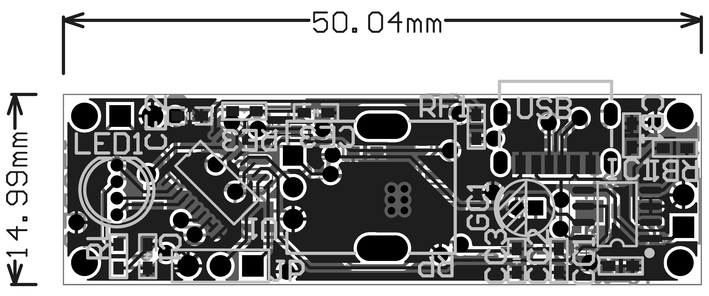

# FloraGuard Pot

FloraGuard Pot is an embedded soil-moisture monitoring and reminder project. The preserved application source compares a capacitive sensor reading with a user-adjustable threshold, indicates soil and battery status through an RGB LED, and switches sensing peripherals off between measurements.

This is an application-source portfolio candidate, prepared through static review. It is not a tested firmware release or a manufacturing package. Photos and a board demonstration can be added later.

## Behavior implemented in the source

- ADC sampling of the soil-sensor output, threshold potentiometer and battery voltage.
- PWM excitation of the sensing circuit, requested at 150 kHz and 50% duty cycle.
- RGB indication based on the soil comparison, battery thresholds and charging-state inputs.
- Switched peripheral power, power-down sleep and interrupt handling.
- UART diagnostics configured for 9600 baud and an optional battery-calibration mode.
- Long-press software reset in the current implementation.

The Pot source has no identified pump, valve or relay irrigation-control path. Configured values are not measurements of frequency, timing, accuracy, power consumption or battery life.

## Design approach

The sensing circuit is designed to convert a capacitance-dependent response into an analog voltage. The application powers the sensing peripherals, applies excitation, waits for settling, samples the inputs, compares the mapped soil reading with the potentiometer setting, and then removes excitation and peripheral power. RGB provides a local interface; serial output supports development and calibration.

The intended MCU family is STC8H1K08, using C with Keil C51 extensions. The actual MCU marking, clock configuration and assembled board revision remain to be confirmed. The associated hardware design uses capacitive sensing, analog conditioning, battery monitoring and USB charging. Native CAD and BOM files are not included; historical display views are available below.

## Hardware design showcase

See the [hardware overview](hardware/HARDWARE_OVERVIEW.md) for the capacitive sensing, analog conditioning, MCU interface and power design, with a [historical schematic](hardware/images/pot-schematic-historical-2025-09-18.png).



Historical design views only: these are not manufacturing files or fresh exports from the current native design. The historical schematic differs from the retained native files at GC1 and RF2; the overview records the values and remaining checks. The PCB image is a monochrome layer overlay, not a verified assembly drawing. No manufacturing or hardware-test pass is claimed.

## Contents

```text
firmware/                       Application C files and local headers
  reference_unbuilt/            Separate battery-calibration entry point
hardware/
  HARDWARE_OVERVIEW.md           Historical schematic and PCB views
  images/                       Historical PNGs, not manufacturing files
docs/
  BUILDING.md                   Missing dependencies and future build procedure
  FIRMWARE_NOTES.md             Static findings and implementation limitations
NEXT_STEPS.md                   Remaining owner confirmations
```

Read the [build status](docs/BUILDING.md), [firmware notes](docs/FIRMWARE_NOTES.md) and [next steps](NEXT_STEPS.md).

This subset intentionally excludes the original Keil startup file and project file, vendor/compiler headers, HEX files, native CAD files, original PDF/BOM exports and local provenance records. It cannot be built directly as supplied. See the build guide for the missing items; no dependencies have been installed or substituted.

## Evidence and limitations

The application files were copied without code edits and checked byte for byte. Project behavior was inspected statically; no build, simulation, programming or board test was performed during preparation.

Known issues include a sleep constant named `SEC_12H` that holds 10,800 seconds, comments describing a third soil state that the current decision function does not return, and a long-press hook whose old name describes sleep while its body resets the MCU. Startup UART ordering and clock configuration also need review. These findings are documented without changing behavior.

Source-to-installed-HEX mapping, physical revision, sensor calibration, timing, current consumption, charging behavior and reliability remain unverified. The withheld hardware exports are not synchronized with every value in the native schematic. No clean DRC, manufacturing readiness or measured performance is claimed.

## Contribution and publication status

I designed and adapted the soil-moisture application flow, RGB indication, and low-power control. Low-level development drew on STC8H manuals and related examples.

The examples' precise provenance and redistribution terms remain under review. Third-party dependencies remain outside this source subset while their terms are unresolved. No project license has been selected. The source subset is not directly buildable as supplied. See the [reference materials](SOURCES.md) for the scope of the source notes.
