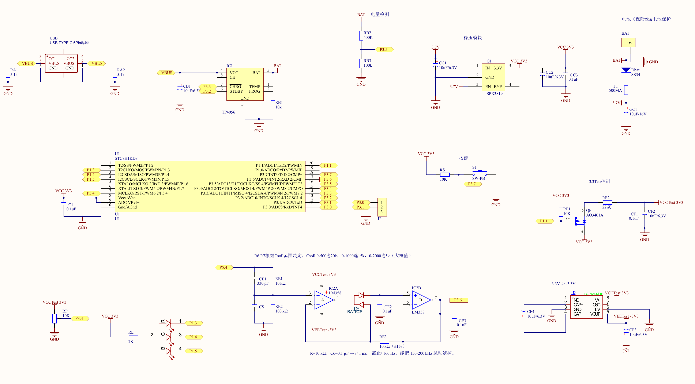

# FloraGuard Pot hardware design

FloraGuard Pot combines capacitive soil sensing, an adjustable local threshold, RGB indication and battery-powered operation. The views below show real historical design artwork associated with the Pot branch. They document circuit structure and board layout, rather than a verified manufacturing release or measured hardware performance.

## Schematic view

**Historical schematic export dated 18 September 2025.** The image preserves the original circuit values and notes. Its GC1 value and RF2 resistor differ from the retained native design snapshot; see the version notes below.

## Circuit structure

| Block | What the design shows |
| --- | --- |
| Capacitive sensing | A capacitance-dependent input driven by MCU excitation, intended to represent the soil sensor response |
| Signal conditioning | LM358 stages, BAT54S diodes and RC filtering, with an analog output connected to P3.6 |
| Controller | An STC8H-family MCU; the symbol reads STC8H1KD8 while the native PCB footprint names STC8H1K08, so the physical marking still needs confirmation |
| User interface | RGB outputs on P1.3/P1.4/P1.5, a rotary threshold input on P3.4 and a button on P3.7 in this historical drawing |
| Sensor power | A switched sensing supply controlled by P1.1; this is not a pump output |
| Charging and supplies | USB-C input, TP4056 charging, battery sensing, SPX3819 regulation and an ICL7660 negative supply for the analog circuit |

The reviewed application source uses PWM excitation on P5.4, samples the soil and threshold signals, controls RGB indication and switches sensing power around measurements. This relationship is established from source and drawing inspection, not a board test. No automatic watering actuator is identified in the Pot design or application path.

## PCB layout view

**Historical monochrome layer overlay from the same PDF collection.** The original drawing labels approximately 50.04 mm by 14.99 mm. It is a routing and placement overview, not a photograph or an assembly/fabrication drawing. Multiple layers and labels overlap, so it should not be used to identify every connection or component position.

## Version and verification notes

- The retained native schematic and PCB have matching sets of 39 unique component designators, stored component values and corresponding source IDs in a limited record-level check. Both record GC1 as 100 uF / 16 V and have no RF2 component. This does not establish matching nets, pad connectivity, geometry or routing.
- The historical schematic shown here records GC1 as 10 uF / 16 V and RF2 as 22 ohms. It has not been reconciled with the native snapshot or an assembled board. Values have not been edited to make the images appear synchronized.
- The MCU symbol, footprint and complete purchasing part number remain to be reconciled with the physical board.
- An existing historical DRC report records 356 violations. It was not rerun, and no DRC pass, manufacturing readiness, sensor accuracy, battery life or other measured result is claimed.
- The native CAD files and BOM are outside this showcase candidate. Embedded paths, external library/model references and redistribution rights still require review. The BOM is not presented as an approved manufacturing list.

The images were rendered from existing PDF pages at 300 dpi and cropped to remove non-design borders, empty margins and a workstation-path footer. Circuit values and explanatory notes were retained; no visible copyright notice was removed. Some unavailable fonts were substituted during rendering, and the resulting images were visually checked. No generative drawing, component editing, simulation or CAD rule check was used.

These historical views are documentation, not manufacturing files. Board photos and measurements can be added separately.
